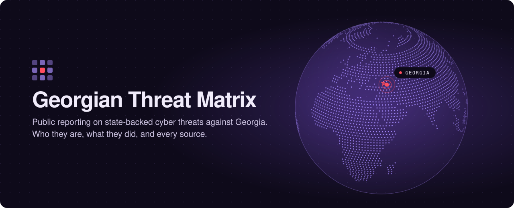

  

# Georgian Threat Matrix

A public, source-linked record of state-backed cyber threats against Georgia.

**Live site: https://in7314u.github.io/georgia-threat-matrix/** (English and Georgian; switch with the button in the top bar)

Reporting on attacks against Georgia is scattered across vendor write-ups, indictments, government statements and news articles, and most of it mentions Georgia only in passing. This project pulls those mentions into one place, so that for each threat actor you can see who they are, what they did in Georgia and when, and read the source for yourself.

## What is on the site

| Page | What you get |
|---|---|
| **Home** | A short introduction, a globe with Georgia marked, and a card for every threat actor. |
| **Threat actors** | One profile per group: a description summarised from MITRE ATT&CK, aliases, attribution, a timeline of activity against Georgia, and every report that mentions it. Also a matrix of which actor targeted which sector. |
| **Timeline** | Every dated event from 2008 onwards, oldest first, filterable by actor. |
| **Sources** | All reports, advisories and articles, searchable by title, publisher and the passages that mention Georgia. |

## What it covers

- **Russian military intelligence (GRU)**: APT28 and Sandworm, including the October 2019 attack that defaced about 15,000 Georgian websites.
- **Russian foreign intelligence (SVR)**: APT29, from the 2009 campaigns against the Ministry of Defence onwards.
- **Other Russia-aligned groups**: Saint Bear (UAC-0056 / Lorec53), Winter Vivern, Curly COMrades and the Georbot botnet.
- **Iran**: MuddyWater.
- **Events with no named group**: the 2008 wartime attacks, the 2020 breach of the health ministry and Lugar Center, and the access to ministries and infrastructure reported in 2024.

## How the data is kept

Everything the site shows lives in one file, [`data/data.js`](data/data.js). There is no build step and no database.

- `actors`: one entry per threat actor.
- `reports`: a source document, its links, and the findings about Georgia taken from it.
- `timeline`: dated events, each pointing back at a report.

Georgian translations of the interface, actor descriptions, timeline and summaries live in [`data/i18n.js`](data/i18n.js). Verbatim quotations from English-language reports are shown in English in both versions.

To add a source, append an entry to `reports` (and to `timeline` if it has a date) and commit. GitHub Pages republishes the site within a minute.

Findings are reproduced from the linked source so they can be checked against it. Entries tagged *summary* on the site are paraphrased rather than quoted.

## Contributing

Know of a report that mentions Georgia and is missing here? Open an issue or a pull request, email balefulshadowv9@gmail.com, or message [@balefulshadowv9](https://x.com/balefulshadowv9) on X.

## Credits

- All reports are public research; credit for the findings belongs to their authors, who are linked from every entry.
- Group descriptions are summarised from [MITRE ATT&CK](https://attack.mitre.org/groups/).
- The globe is drawn from [Natural Earth](https://www.naturalearthdata.com/) country outlines (public domain).
